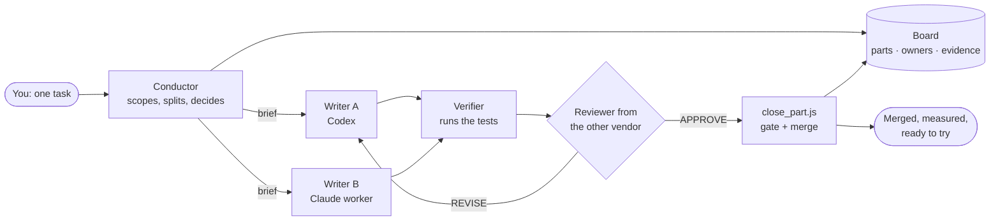

# Orkestra

A Claude Code plugin that splits a coding job across several agents, has a model from another vendor review each change, and lets a script — not a model — decide whether the change is merged.

[Türkçe](README.tr.md) · MIT · `0.6.3` · test suite passes on Linux, macOS and Windows

A **conductor** plans and decides. **Writers** each own their own files. A **reviewer from the other vendor** (Codex reviews Claude's work, Claude reviews Codex's) looks for bugs. A small **verifier** runs the tests. An agent's "done" counts only with the commands it ran and their exit codes.

```text
/orkestra:orkestra add offline caching to the reader and cover it with tests
```

## What it is for

Orkestra is meant for large jobs: building a website, a game, an app or a tool, editing video, anything that runs across many files, steps or sessions. On such jobs it saves effort by giving each part to the cheapest model that can finish it, by keeping the conductor from re-reading everything, and by catching bugs before they are merged. It is developed by using it on real work in each of these areas; every area it is tried on adds tests and rules to it.

| Area | Status |
|---|---|
| Games (2D, 3D, web and Godot) | In use; measured (table below) |
| Websites | In use; measured on a shop site |
| Apps and tools | In use |
| Video editing | In use; measured on a storyboard teaser |

## Evidence so far

The figures below come from the author's own projects (anonymized; full log in [docs/measurements.md](docs/measurements.md)).

| Job | Setup | Measured result |
|---|---|---|
| Godot game, one large batch of work | Same scale of work before and after Orkestra | Claude cache reads 355 M → 23.7 M (about 15× less); Codex reviews found real bugs in 9 of 13 rounds |
| Web game: style guide, concept frames, UI, implementation | Codex wrote and drew, 3 independent reviews | 2 real bugs found before merge |
| Same game: 13 3D models (GLB) | 2 Codex writers in parallel, separate files | No merge conflicts |
| Same game: effects and enemy redesign | 5 Codex writes, 1 review, 1 smoke run | Review found 2 bugs, the smoke run 2 more |
| Static shop site, unrelated project | 2 small fixes, as a test of the merge gate | Found that the site's `node --test` ran no tests while reporting "12 passed"; no wrong refusals by Orkestra |
| Animated series: 9:16 teaser from approved storyboards | Codex chose shots, crops and titles; a Claude worker wrote the ffmpeg pipeline | 22.6 s teaser; Codex reviews found 9 real bugs in the pipeline; the designer's check caught 3 look errors from Codex |
| 12 days of normal use | 46 sessions | 673 Codex calls, 144 worker runs, 91 verifier runs |

## Who it is for

- You use **Claude Code** and your jobs span several files, several steps or several sessions.
- You want a model from **another vendor** (OpenAI Codex by default) to review what Claude writes, and the other way round.
- You want to see what a job cost per agent and model.

For a one-file change under ~150 lines the crew adds overhead; Orkestra detects that and does the change directly.

## How a job flows



1. **Scope.** The conductor checks what already exists and asks you only what changes the direction, plus once per job how often to check in: `auto` (run to the end), `checkpoints` (approve the plan, then a short progress note and the open decisions after each merged part) or `ask` (every decision).
2. **Split.** The job becomes parts on a board (`.orkestra/<job>/board.md`, git-ignored). Each part owns its files, so parallel writers never touch the same file.
3. **Write.** Each part goes to the cheapest instrument that can finish it: Codex for wide or visual work, a Claude worker for code that must be run to be finished, Haiku for mechanical edits.
4. **Verify.** A small model runs the acceptance command. A writer can't approve its own work.
5. **Review.** The other vendor reviews the exact commits that will be merged, from a diff file, and returns a fixed JSON verdict.
6. **Merge.** `close_part.js` merges only if the review passed **and** covers exactly those commits; a high-risk part needs two independent reviews.
7. **Measure.** `/orkestra:measure` shows what each agent cost and checks the run against the rules.

## Quick start

**1. Install the plugin**
```bash
claude plugin marketplace add forvanius/orkestra
claude plugin install orkestra@orkestra
```

**2. Install and log in to Codex** (the default second vendor)
```bash
npm i -g @openai/codex
codex login
```
Keep it up to date: an old Codex CLI rejects new models with "model is not supported". No Codex? Claude Code itself (`claude -p`) can be the second writer and reviewer — see [docs/instruments.md](docs/instruments.md).

**3. Pick your Codex model.** Claude Code asks for it when the plugin is enabled (change it later in `/config`).

**4. Run a job** in your project:
```text
/orkestra:orkestra <what you want done>
```

**5. Measure it** when it's done:
```text
/orkestra:measure
```

Requirements: [Claude Code](https://code.claude.com), Node.js, git. Developed and piloted on Windows; the CI runs the test suite on Windows, macOS and Linux.

## What you get at the end

- Merged commits on your branch, each part reviewed by the other vendor and checked by a test run.
- A board that records every part, its writer, its review and its evidence; a new session uses it to continue.
- For a job that changes something you can open or run: a short note on how to open it, what to try and what is unfinished, with desktop and mobile captures.
- A cost table: calls and token reads per agent and model, compared with your previous run.

What a part's evidence looks like on the board:
```text
| A | codex | merged | src/reader.js, tests/reader.test.js | npm test -- reader | 3f9c2a1 | review=review-A.json |
```

## How changes are checked

- Every agent returns a verdict with the commands it ran and their exit codes; an approval without them counts as a rejection.
- Each brief forbids deleting or loosening tests, changing thresholds and swallowing errors; the reviewer checks the diff for these.
- `red_check.js` runs a new test with the fix (it must pass) and without it (it must fail), then restores the files as they were.
- A review covers specific commits; a commit added after it needs its own review.
- Orkestra runs no destructive git command in your working tree and won't merge while your own merge or cherry-pick is in progress.

## Settings

| Option | What it does |
|---|---|
| `codex_model` | Model for every `codex exec` call (writing, reviewing). |
| `codex_model_design` | Optional stronger model for design: concepts, images, 2D/3D asset tuning. |
| `codex_model_light` | Optional cheaper Codex model for mechanical parts (else a Haiku worker). |
| `gemini_model` | Only if you add Google's CLI as a writer or reviewer. |

Set them in `/config` or in `settings.json` under `pluginConfigs["orkestra@orkestra"].options`. Put recurring project rules in your repo's `AGENTS.md`: Claude agents and Codex both read it, so briefs stay short.

## FAQ

**What does it cost?** It depends on the job. In the measured runs, Claude cache reads dropped about 15× against an all-Claude setup of the same scale; Codex usage is on your OpenAI plan and is not in that figure. `/orkestra:measure` shows the numbers for your own runs.

**What if Codex hits its limit?** `guarded.js` checks your Codex quota before every run. Near the limit it stops and the conductor asks you: wait, or route the part to Claude.

**Can I stop and continue tomorrow?** Yes. The board is the handoff note; a new session reads it and picks up the open parts. A hook tells the conductor when its context has grown enough that a fresh session would be cheaper.

**Which languages?** The skill is written in English; the conductor talks to you in your language. Boards may use English or Turkish headers.

## More

- [docs/example.md](docs/example.md) — a full job, step by step
- [docs/instruments.md](docs/instruments.md) — Codex, Claude Code headless and Gemini/Antigravity recipes
- [docs/measurements.md](docs/measurements.md) — the runs behind the rules
- [skills/orkestra/SKILL.md](skills/orkestra/SKILL.md) — the conductor's rules

## Status

`0.6.3`. Codex writes by default, Sonnet workers handle local debugging and hard multi-file changes, and Haiku runs short checks. Background batches report once. You give direction, approve decisions and get a short note for the agreed real-world test. At checkpoints, `usage_sum.js --here --budget <board>` compares Claude reads, conductor reads and elapsed time with the plan. `guarded.js quota` estimates Claude's five-hour usage.

In use on the author's projects since October 2026. The merge gate (reviews bound to commits, two reviews for high-risk parts, the red check) has run in five pilot jobs, one on an unrelated project. Issues and your own numbers (calls, reads per role, bugs found) are welcome.

## Possible next steps

Not built yet; listed so the direction is clear.
- A decision log: key decisions of each job kept across jobs, so a later job doesn't reopen them.
- Browser and visual checks: today they run if the project has them (for example Playwright) and the acceptance command calls them; a short setup recipe could make that easier.

## Usage notes

- Package each review with `review_package.js` and name its result `review-<name>.json`; `close_part.js` merges exactly what those reviews cover.
- Run `red_check.js` without an outside timeout that kills the test.

## License

[MIT](LICENSE)
