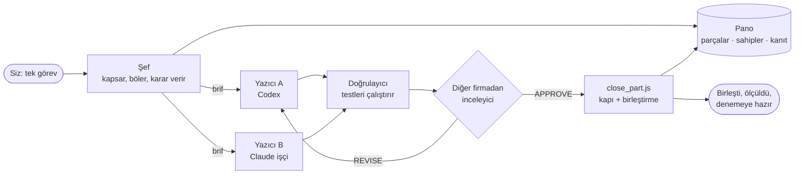

# Orkestra

**Claude Code'da büyük kodlama işlerini tek uzun sohbet yerine bir ekip gibi yürütün — her değişikliği birleşmeden önce ikinci bir yapay zekâ denetlesin.**

[English](README.md) · MIT · deneysel (`0.6.0`)

Claude Code'a tek bir görev verirsiniz. Orkestra onu küçük bir ekibe dönüştürür: planlayıp karar veren bir **şef**, her biri kendi dosyalarının sahibi olan **yazıcılar**, hata arayan **başka bir yapay zekâ firmasından bir inceleyici** ve testleri gerçekten çalıştıran ucuz bir **doğrulayıcı**. Hiçbir şey birinin sözüyle birleşmez: her "bitti", onu kanıtlayan komutlarla gelmek zorundadır ve bir değişikliğin girip girmeyeceğine bir model değil, bir betik karar verir.

```text
/orkestra:orkestra okuyucuya çevrimdışı önbellek ekle ve testlerle kapsa
```

## Kimin için

- **Claude Code** kullanıyorsunuz ve işleriniz büyüyor: birkaç dosya, birkaç adım, tek oturumu aşan işler.
- Claude'un yazdığını **başka bir firmanın modeli** (varsayılan olarak OpenAI Codex), Codex'in yazdığını da Claude incelesin istiyorsunuz.
- Maliyeti önemsiyorsunuz. Uzun işlerde en pahalı şey, şefin gördüğü her şeyi tekrar tekrar okumasıdır; Orkestra şefi okuma ve yazmanın dışında tutar.

**Uygun değil:** tek dosyalık bir düzeltme ya da ~150 satırın altındaki bir değişiklik. Orkestra bunu kendisi söyler ve bu işleri doğrudan yapar.

## Bir iş nasıl akar



1. **Kapsam.** Şef neyin zaten var olduğuna bakar ve size yalnızca yönü değiştiren soruları sorar.
2. **Bölme.** İş bir panoda (`.orkestra/<iş>/board.md`, git'e girmez) parçalara ayrılır. Her parça kendi dosyalarının sahibidir; paralel yazıcılar asla aynı dosyaya dokunmaz.
3. **Yazma.** Her parça onu bitirebilecek en ucuz araca gider: geniş ya da görsel işler Codex'e, bitirmek için çalıştırılması gereken kod bir Claude işçiye, mekanik düzenlemeler Haiku'ya.
4. **Doğrulama.** Küçük bir model kabul komutunu çalıştırır. Yazıcı kendi işini onaylayamaz.
5. **İnceleme.** Diğer firma, birleşecek commit'lerin tam olarak kendisini bir diff dosyasından inceler ve sabit bir JSON karar döner.
6. **Birleştirme.** `close_part.js` yalnızca inceleme geçtiyse **ve** tam o commit'leri kapsıyorsa birleştirir; yüksek riskli bir parça iki bağımsız inceleme ister.
7. **Ölçme.** `/orkestra:measure` her ajanın maliyetini gösterir ve koşuyu kurallara göre denetler.

## Hızlı başlangıç

**1. Eklentiyi kurun**
```bash
claude plugin marketplace add forvanius/orkestra
claude plugin install orkestra@orkestra
```

**2. Codex'i kurup giriş yapın** (varsayılan ikinci firma)
```bash
npm i -g @openai/codex
codex login
```
Güncel tutun: eski bir Codex CLI yeni modelleri "model is not supported" diye reddeder. Codex yok mu? Claude Code'un kendisi (`claude -p`) ikinci yazıcı ve inceleyici olabilir — bkz. [docs/instruments.md](docs/instruments.md).

**3. Codex modelinizi seçin.** Eklenti etkinleşince Claude Code sorar (sonradan `/config` ile değiştirilir).

**4. Projenizde bir iş başlatın:**
```text
/orkestra:orkestra <yapılmasını istediğiniz şey>
```

**5. Bitince ölçün:**
```text
/orkestra:measure
```

Gerekenler: [Claude Code](https://code.claude.com), Node.js, git. Windows'ta geliştirildi ve pilot işlerle denendi; CI test takımını Windows, macOS ve Linux'ta çalıştırır.

## Sonunda elinizde ne olur

- Dalınızda **birleşmiş commit'ler**: her parça diğer firmaca incelenmiş ve bir test koşusuyla doğrulanmış.
- Her parçayı, kimin yazdığını, incelemesini ve kanıtını kaydeden **bir pano** — iş birden çok oturuma yayılırsa devir notu da odur.
- Açıp çalıştırabileceğiniz her şey için **kısa bir rapor**: nasıl açılır, neyi denemeli, ne bitmedi; masaüstü ve mobil ekran görüntüleriyle.
- **Bir maliyet tablosu**: ajan ve model başına çağrı ve token okuması, bir önceki koşunuzla karşılaştırmalı.

Panoda bir parçanın kanıtı şöyle görünür:
```text
| A | codex | merged | src/reader.js, tests/reader.test.js | npm test -- reader | 3f9c2a1 | review=review-A.json |
```

## Bir "bitti"ye neden güvenebilirsiniz

- **Rapor değil kanıt.** Her ajan bir kararla birlikte çalıştırdığı komutları ve çıkış kodlarını döner. Kanıtsız bir onay ret sayılır.
- **Kale direkleri yerinde kalır.** Her brif testleri silmeyi ya da gevşetmeyi, eşik değiştirmeyi, hata yutmayı yasaklar; inceleyici diff'te tam olarak bunlara bakar.
- **Testin hatayı yakaladığının kanıtı.** `red_check.js` yeni testi düzeltmeyle (geçmeli) ve düzeltme olmadan (kalmalı) çalıştırır, sonra dosyalarınızı aynen geri koyar.
- **Commit'e bağlı inceleme.** İncelemeden sonra eklenen bir commit onun onayıyla giremez.
- **Çalışmanız güvende.** Çalışma ağacınızda yıkıcı git komutu yok; siz kendi merge'ünüzün ya da cherry-pick'inizin ortasındayken birleştirme çalışmayı reddeder.

## Ayarlar

| Seçenek | Ne yapar |
|---|---|
| `codex_model` | Her `codex exec` çağrısının modeli (yazma, inceleme). |
| `codex_model_design` | İsteğe bağlı, tasarım için daha güçlü model: konseptler, görseller, 2D/3D varlık ayarı. |
| `codex_model_light` | İsteğe bağlı, mekanik parçalar için daha ucuz Codex modeli (yoksa Haiku işçi). |
| `gemini_model` | Yalnızca Google'ın CLI'ını yazıcı ya da inceleyici olarak eklerseniz. |

`/config` ile ya da `settings.json` içinde `pluginConfigs["orkestra@orkestra"].options` altından ayarlanır. Tekrarlanan proje kurallarını reponuzun `AGENTS.md` dosyasına yazın: Claude ajanları da Codex de okur, brifler kısa kalır.

## Sık sorulanlar

**Para kazandırır mı?** Bizim koşularımızda aynı ölçekteki iş, tamamen Claude ile yürütülen bir orkestrasyondan yaklaşık **15 kat daha az Claude önbellek okuması** tuttu; Codex incelemeleri 13 turun 9'unda gerçek hata buldu. Bu yalnızca Claude token'larını sayar; Codex kendi planıyla çalışır. Ayrıntı: [docs/measurements.md](docs/measurements.md).

**Codex limitine takılırsa?** `guarded.js` her çalıştırmadan önce Codex kotanıza bakar. Sınıra yaklaşınca durur ve şef size sorar: beklemek mi, parçayı Claude'a vermek mi.

**Bırakıp yarın devam edebilir miyim?** Evet. Pano devir notudur; yeni bir oturum onu okuyup açık parçalardan devam eder. Şefin bağlamı yeni bir oturumun daha ucuz olacağı kadar büyüyünce bir hook bunu söyler.

**Hangi diller?** Beceri İngilizce yazılmıştır; şef sizinle sizin dilinizde konuşur. Panolar İngilizce ya da Türkçe başlık kullanabilir.

## Daha fazlası

- [docs/example.md](docs/example.md) — baştan sona bir iş
- [docs/instruments.md](docs/instruments.md) — Codex, Claude Code (headless) ve Gemini/Antigravity tarifleri
- [docs/measurements.md](docs/measurements.md) — kuralların arkasındaki koşular
- [skills/orkestra/SKILL.md](skills/orkestra/SKILL.md) — şefin kuralları

## Durum ve bilinen sınırlar

`0.6.0`, deneysel. Oyun ve web projelerinde ölçüldü; birleştirme yolu biri ilgisiz bir projede olmak üzere beş pilot işte çalıştı. En değerli katkı, kendi koşularınızdan gelen rakamlar.

- `close_part.js` yalnızca `review_package.js` ile paketlenmiş commit'leri birleştirir; elle yazılmış ya da `review-<ad>.json` dışında adlandırılmış bir inceleme reddedilir.
- `red_check.js`, Windows'ta dışarıdan öldürülen bir testi başarısız bir testten ayıramaz; testi öldüren bir zaman sınırıyla çalıştırmayın.

## Lisans

[MIT](LICENSE)
